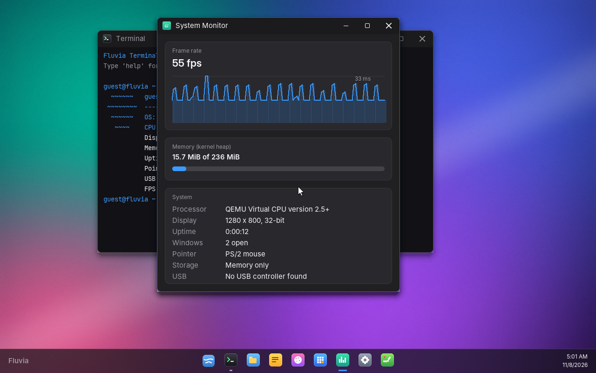
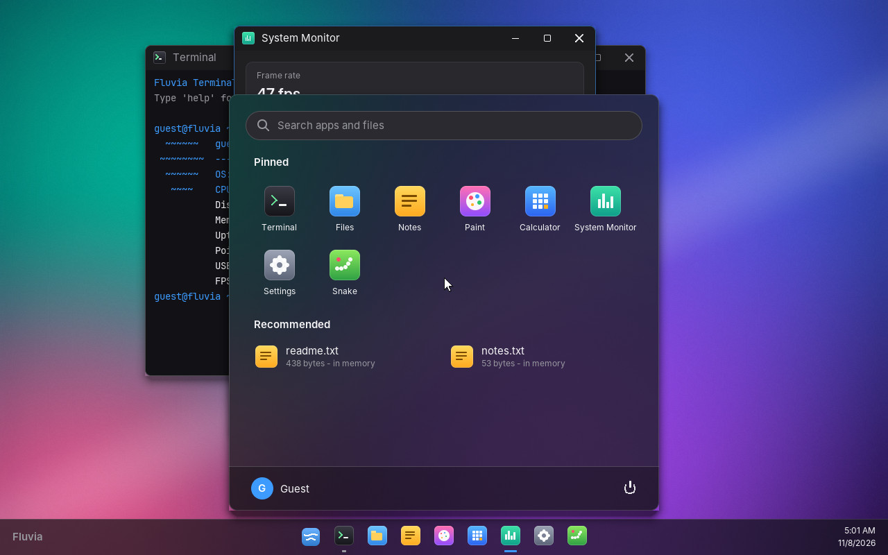
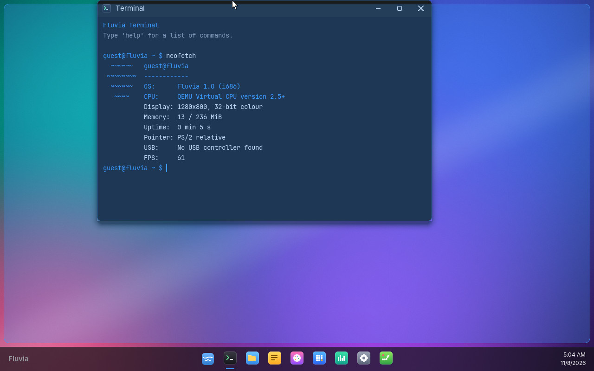
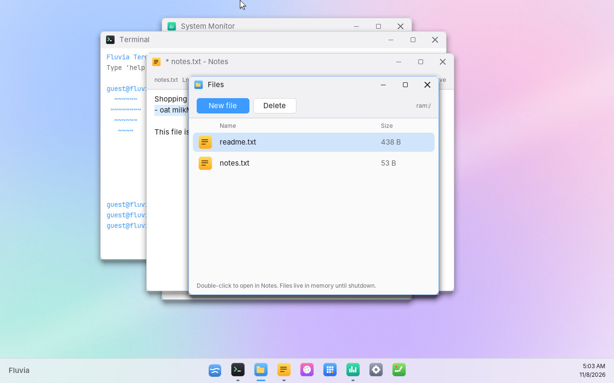

# Fluvia

**A from-scratch x86 operating system with a fluid, compositing desktop.**
It boots from an ISO on a PC or in a virtual machine on Windows, with no Linux
underneath. The kernel, drivers, window manager, renderer and apps are all in
this folder and were written for Fluvia.

The name comes from the Latin *fluvius*, "river": everything on screen is
meant to flow. The logo is two waves.



| Start menu with live search | Aero-style snapping | Light mode |
|---|---|---|
|  |  |  |

## What makes it fluid

* **Compositing window manager.** Every window renders into its own surface.
  A compositor redraws only damaged rectangles of a back buffer and copies them
  to the screen, frame-paced at about 60 fps on a 1000 Hz timer. Under
  QEMU's *software* CPU emulation it holds 55 to 62 fps.
* **Time-based animations with easing:** window open/close (scale + fade),
  minimise into its taskbar icon and restore out of it, maximise/snap morphs,
  a Start menu that slides up, toasts that spring in, taskbar hover fades, and
  stretchy running indicators. Settings → Animations switches between Normal,
  Relaxed (slower) and Off.
* **Modern rendering:** anti-aliased text (Inter and JetBrains Mono,
  pre-rasterised), anti-aliased rounded corners, soft drop shadows, and
  "acrylic" blur behind the taskbar, Start menu and notifications. The
  wallpaper is generated procedurally at boot.
* **Window management:** drag, resize from any edge, double-click the title
  bar to maximise, drag to the top or sides to snap (with an animated
  preview), and drag a maximised window down to restore it under the cursor.
* **Files and settings that persist.** With a virtual hard disk attached,
  Fluvia keeps your files, theme, accent, wallpaper and animation speed
  across reboots (see [Storage](#storage)).
* **USB keyboards, mice and tablets** through its own USB 3 (xHCI) driver,
  including devices behind hubs and plugging/unplugging while running. PS/2
  keyboards and mice work too.
* **Seamless mouse in VMs.** Fluvia speaks the VMware/QEMU/VirtualBox
  absolute-pointer protocol, so the cursor follows your Windows mouse without
  being captured. It falls back to a normal PS/2 mouse with acceleration
  and scroll wheel.

## Apps

| App | What it does |
|---|---|
| **Terminal** | Shell with history, Tab completion, Ctrl+V paste, line wrapping and ~28 commands (`help`, `ls`, `cat`, `write`, `rm`, `edit`, `open`, `ps`, `kill`, `calc`, `disk`, `neofetch`, `theme`, `wallpaper`, `anim`, `reboot`, `shutdown`, ...) |
| **Files** | Browse, create and delete files; double-click opens them in Notes |
| **Notes** | Text editor: selection with Shift+arrows, mouse drag or double-click, Ctrl+A/C/X/V, undo/redo (Ctrl+Z/Y), word jumps (Ctrl+arrows), smart Home, auto-indent, Ctrl+S, autosave on close |
| **Paint** | Smooth anti-aliased brush, 10 colours, 3 sizes |
| **Calculator** | Mouse and keyboard input, animated keys, chained operations |
| **System Monitor** | Live frame-time graph, FPS, memory, CPU model, uptime |
| **Settings** | Dark/light mode, 6 accent colours, 4 wallpapers, animation speed |
| **Snake** | Arcade game with smoothly interpolated movement |

### Keyboard shortcuts

| Keys | Action |
|---|---|
| <kbd>Win</kbd> | Open/close Start (then type to search, <kbd>Enter</kbd> to launch) |
| <kbd>Alt</kbd>+<kbd>Tab</kbd> | Cycle windows |
| <kbd>Alt</kbd>+<kbd>F4</kbd> | Close window |
| <kbd>Alt</kbd>+<kbd>↑</kbd> / <kbd>←</kbd> / <kbd>→</kbd> | Maximise / snap left / snap right |
| <kbd>Alt</kbd>+<kbd>↓</kbd> | Restore, or minimise |
| <kbd>Ctrl</kbd>+<kbd>Alt</kbd>+<kbd>T</kbd> | New Terminal |

Caps Lock, Num Lock (with keyboard LEDs) and the numeric keypad work. Hover
over a window edge to get a resize cursor.

## Run it on Windows

Get `fluvia.iso`: download the **fluvia-iso** artifact from the
**Fluvia** GitHub Actions workflow, or [build it](#build-it).

### VirtualBox (easiest)
1. *New* → Type **Other**, Version **Other/Unknown**, 256 MB RAM.
   Let it create a small virtual hard disk (any size from 4 MB): Fluvia keeps
   your files there. IDE and SATA controllers both work.
2. *Settings → Display*: Graphics Controller **VBoxVGA** or **VMSVGA**, 16 MB+ video memory.
3. *Settings → Storage*: attach `fluvia.iso` to the optical drive. Start.

Mouse and keyboard work with VirtualBox's defaults (PS/2 with seamless mouse
integration), and also with *Settings → USB → USB 3.0 (xHCI) Controller* and
a USB tablet.

At boot a menu offers the default resolution (1280×800), Full HD, 1024×768
and a safe 800×600 mode. It starts the default after 3 seconds.

### QEMU for Windows
```powershell
qemu-img create -f raw disk.img 32M        # once: a blank disk for your files
qemu-system-x86_64 -cdrom fluvia.iso -drive file=disk.img,format=raw,if=ide -boot d -m 256M -vga std
# add  -accel whpx  for hardware acceleration (requires Windows Hypervisor Platform)
```

### Hyper-V
Use a **Generation 1** VM (it emulates the PS/2 keyboard and mouse Fluvia
drives) and boot the ISO from its DVD drive.

### Real hardware (USB stick)
Write the ISO with [Rufus](https://rufus.ie) in **DD image** mode, disable
Secure Boot, and boot from USB. The ISO boots in both UEFI and legacy BIOS mode.
USB keyboards and mice work through Fluvia's xHCI driver (any PC from about
2013 onwards), and PS/2 devices and most laptops' built-in keyboards work
directly. If a keyboard or mouse ever stops responding on unusual hardware,
pick **"Fluvia (without USB driver)"** in the boot menu: the firmware's own
USB emulation then stays in charge.

## Storage

Fluvia stores files on an IDE/ATA or SATA (AHCI) disk using its own simple format
(FluviaFS: 32 files, up to 64 KiB each). On boot it looks for a disk that
either already holds FluviaFS or is **completely blank** (its first 32 KiB are
zero, as on a new virtual disk) and formats that one. **It never writes to a
disk with any other content**, so an existing Windows, Linux or data disk is
never touched. Without a suitable disk everything still works, and files stay
in memory until shutdown. Settings → bottom of the page and the `disk`
command show which mode is active. Files whose names start with `.` (like
`.settings`) are hidden from Files and Start; `ls -a` shows them.

## Build it

On Linux, or in **WSL** on Windows (`wsl --install -d Ubuntu`):

```bash
sudo apt install build-essential nasm grub-pc-bin grub-efi-amd64-bin grub-common xorriso mtools qemu-system-x86
make -C os          # -> os/build/fluvia.iso
make -C os run      # boot it in QEMU with a persistent disk (os/build/disk.img)
os/tools/smoke_test.sh os/build/fluvia.iso   # headless BIOS + UEFI boot check
os/tools/e2e.sh os/build/fluvia.iso          # drives every app, reboots, checks persistence;
                                               # then a UEFI + q35 + SATA + USB-only run with hub hot-plug
```

## How it's built

```
boot/boot.asm     Multiboot2 header (asks GRUB for a linear framebuffer), stack, FPU, -> kmain
boot/isr.asm      interrupt stubs, GDT/IDT loading
kernel/main.c     boot: memory map, hardware init, splash, 60 fps frame loop
kernel/cpu.c      GDT, IDT, 8259 PIC, PIT timer (1 kHz), CMOS clock, CPUID, reboot/power-off
kernel/input.c    PS/2 keyboard (scan set 1), PS/2 + IntelliMouse wheel, vmmouse absolute pointer
kernel/mem.c      first-fit heap with coalescing
kernel/gfx.c      rasteriser: AA shapes, blending, rounded/scaled blits, shadows, text, blur
kernel/wm.c       compositor, damage tracking, window lifecycle and animations, input routing
kernel/shell.c    theme, wallpaper generator, icons, taskbar, Start menu, toasts
kernel/anim.c     easing curves (cubic, quint, back, spring)
kernel/fs.c       file table, clipboard
kernel/storage.c  ATA PIO driver and FluviaFS persistence
kernel/ahci.c     SATA (AHCI) driver
kernel/usb.c      xHCI driver: HID keyboards/mice/tablets, hubs, hot-plug
kernel/pci.c      PCI enumeration
kernel/paging.c   PAE paging: identity map + window for devices above 4 GiB
kernel/acpi.c     ACPI shutdown (S5) and reset, with fallbacks
apps/*.c          the apps; each is an app_t with init/paint/key/mouse/tick/close callbacks
tools/genfont.py  rasterises the fonts into kernel/fontdata.h (output is committed)
```

Apps draw into their window's surface and call `wm_invalidate()`. The window
manager repaints dirty windows, records damaged rectangles (merging those that
overlap), and composites wallpaper → windows (with shadows) → snap preview →
taskbar → Start menu → toasts → cursor for each damaged rectangle before
copying them to the framebuffer.

## Limitations

Fluvia is a real OS but a young one. It does not replace Windows.

* 32-bit, single core, everything runs in ring 0 with no memory protection
  between apps (cooperative: apps are callbacks in the compositor loop).
* Storage: IDE and SATA (AHCI) disks are supported, NVMe drives and USB
  sticks are not. On a real PC Fluvia will normally keep files in memory,
  because it only ever writes to a blank or Fluvia-formatted disk.
* USB: keyboards, mice, tablets and hubs only (no USB storage, audio, etc.).
  Older USB 1/2-only controllers (pre-2013 PCs) are left to the firmware's
  legacy emulation. I2C laptop touchpads are not supported, so use a USB or
  PS/2 mouse.
* No network or sound drivers.
* Graphics are software-rendered into the firmware framebuffer, so the
  resolution is whatever GRUB sets (1280×800 requested).
* It can't run Windows programs.

## Licence and credits

Fluvia is part of this repository and is under the repository's licence.
The UI fonts are [Inter](https://rsms.me/inter/) and
[JetBrains Mono](https://www.jetbrains.com/lp/mono/), both under the SIL Open
Font License 1.1. They are pre-rendered into `kernel/fontdata.h`.
